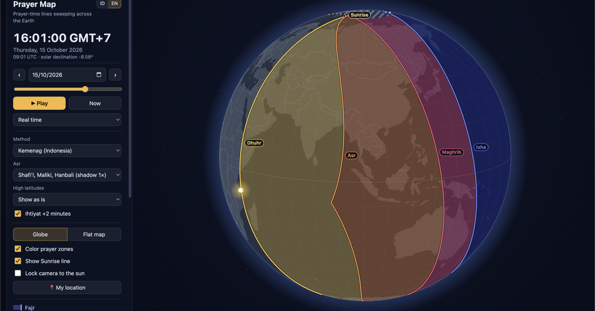

# Peta Sholat

*English: [README.md](README.md)*

**▶ Coba langsung: https://mirzaakhena.github.io/peta-sholat/**

> Biasanya aplikasi sholat bertanya: **"Di lokasi saya, Ashar jam berapa?"**
>
> Aplikasi ini membalik pertanyaannya: **"Pada detik ini, di mana saja di bumi yang sedang masuk waktu Ashar?"**



Peta interaktif yang memperlihatkan **garis waktu sholat** (Subuh, Terbit, Zuhur, Ashar, Maghrib, Isya) menyapu permukaan bumi. Setiap garis menghubungkan semua titik yang *pada detik yang sama* sedang memasuki waktu sholat tersebut. Area di antara garis diwarnai sesuai waktu sholat yang sedang berlangsung.

## Menjalankan

Tanpa build step. Cukup buka `index.html` di browser, atau jalankan:

```sh
python3 -m http.server 8000   # lalu buka http://localhost:8000
```

## Struktur

- `js/astro.js` — posisi matahari, sudut jam tiap waktu sholat, zona, dan jadwal per titik. Bisa dipakai di Node (`require('./js/astro.js')`).
- `js/i18n.js` — terjemahan antarmuka (Bahasa Indonesia & English). Teks di HTML ditandai `data-i18n`, teks dinamis memakai `I18n.t()`.
- `js/app.js` — rendering globe/peta datar (D3 + canvas), animasi waktu, dan interaksi.
- `vendor/` — D3 7.9.0, topojson-client 3.1.0, dan peta dunia `world-atlas` 110m.

## Cara kerja singkat

Waktu sholat ditentukan oleh sudut jam lokal matahari: `LHA = GHA(t) + bujur`. Untuk tiap lintang, dihitung sudut jam `H` saat peristiwa terjadi (misalnya matahari −20° untuk Subuh Kemenag). Pada instan `t`, garisnya berada di `bujur = H − GHA(t)`. Di lintang tinggi, sebagian peristiwa tidak terjadi (misalnya matahari tidak turun sampai −18°), sehingga garisnya berhenti.

## Lintang tinggi

Di lintang tinggi, sebagian peristiwa tidak terjadi (senja tidak hilang, atau matahari tidak terbit/terbenam). Pilihan "Lintang tinggi" di panel:

- **Tampilkan apa adanya** (default): zona yang awal/akhirnya tidak terjadi diarsir, dan ujung garis diberi titik bulat.
- **Aqrab al-bilad**: waktu yang hilang diambil dari lintang 45° di belahan yang sama. Saat malam/siang kutub, semua waktu diambil dari 45°.
- **Tengah malam / sepertujuh malam / berbasis sudut**: hanya mengisi Isya & Subuh, dan butuh matahari terbit & terbenam.

Garis hasil aturan digambar putus-putus samar, dan di jadwal titik ditandai `*`.
